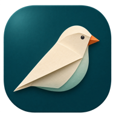
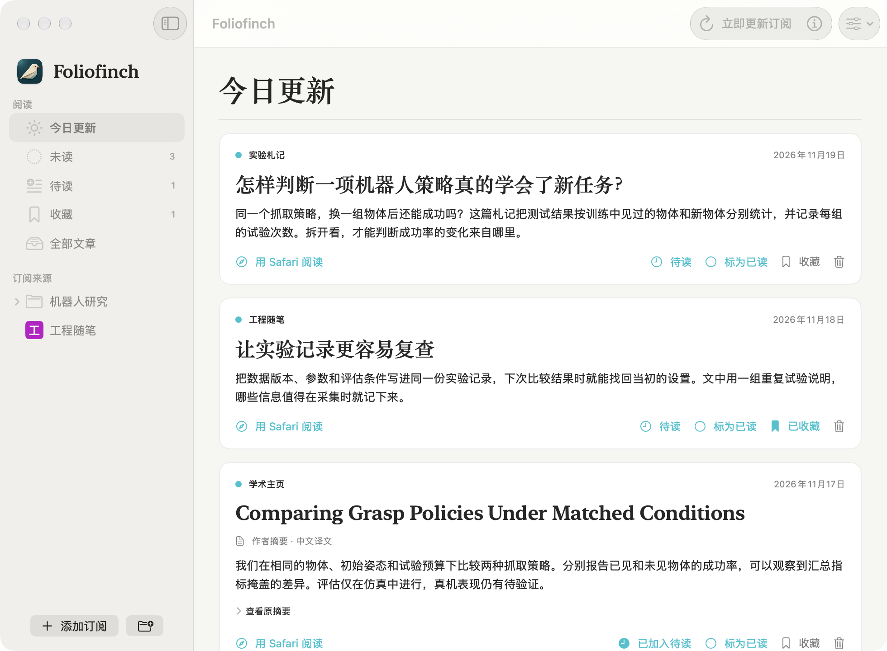

#  Foliofinch

Foliofinch 是一款 macOS 科研阅读器。订阅博客或个人学术主页，每次更新后就能读到博客的中文导读和论文作者摘要的中文译文，再决定哪些值得去 Safari 细读。（建议搭配 Obsidian web Clipper 一起使用😋）

**[下载 macOS 安装包](https://github.com/Semt0/Foliofinch/releases/latest/download/Foliofinch-macOS-arm64.dmg)** · Apple Silicon（M 系列芯片）· macOS 14 或更高版本

*图中订阅、文章和论文均为演示内容。*

## 开始使用

1. 打开 DMG，将 **Foliofinch** 拖入「应用程序」并启动。升级时退出旧版，用新版替换即可。订阅、阅读记录和已下载的模型保存在应用包之外。
2. 首次打开时选择摘要方式。「免费本机模型」会在首次需要时下载约 1.12 GB 的 Qwen2.5-1.5B，在 Mac 上生成中文。「自有 API」需填写兼容 Chat Completions 的 HTTPS 地址、模型名和密钥，博客节选和论文摘要会发给该服务。之后可在「设置 → 摘要设置」切换。
3. 点「添加订阅」，粘贴博客主页、文章列表或 RSS / Atom 地址。没有 RSS 的网站可以预览识别到的文章。个人学术主页若有论文栏目和 arXiv 链接，可选「订阅论文」，从最近三篇开始跟踪。

安装包未经 Apple 公证。如果 macOS 阻止首次打开，确认下载来源后，可在「系统设置 → 隐私与安全性」点「仍要打开」。[Apple 操作说明](https://support.apple.com/zh-cn/102445)

## 日常阅读

| 想做什么 | 在哪里操作 |
| --- | --- |
| 查看更新 | 登录 Mac 期间默认每天 09:00 自动检查，关闭窗口后也会运行。在「设置 → 更新计划」可改为每小时、每天或每周，指定检查时间。点「立即更新订阅」或按 ⌘R 可手动检查。 |
| 阅读论文 | 在文章卡片读中文译文，点「查看原摘要」对照作者原文。点「用 Safari 阅读」打开论文或博客原文。 |
| 稍后再读 | 点文章上的「待读」，在侧栏集中查看。已读、待读和收藏可分别管理。删除文章后，后续更新会跳过同一链接。 |
| 整理订阅 | 点侧栏底部的文件夹加号新建分类，右键订阅选择「移到文件夹」。点击文件夹即可一起浏览其中的文章。 |

## 名称由来

*Folio* 指书页，*finch* 是雀鸟。Foliofinch 的名字取自一只小雀每天衔来新书页的意象。

Copyright © 2026 Semt0 · [MIT License](LICENSE)
